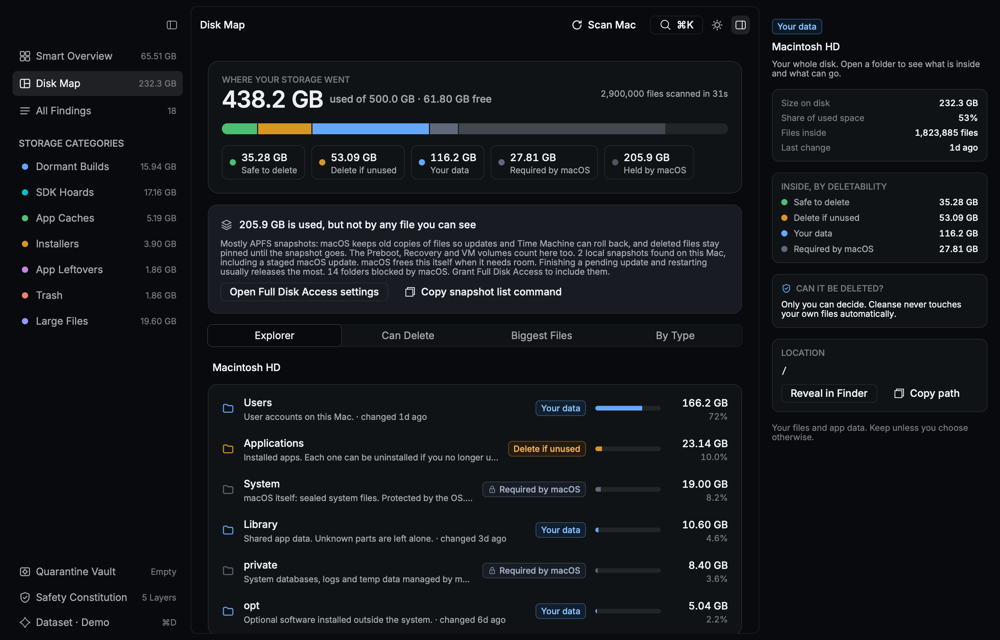
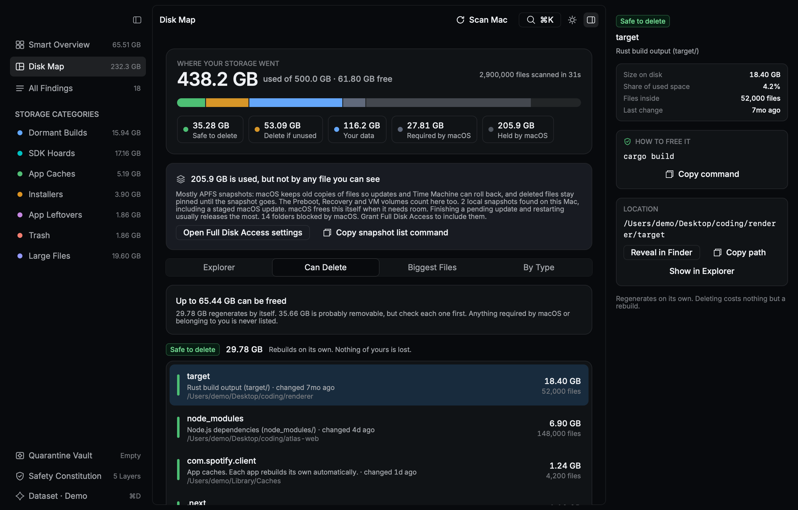
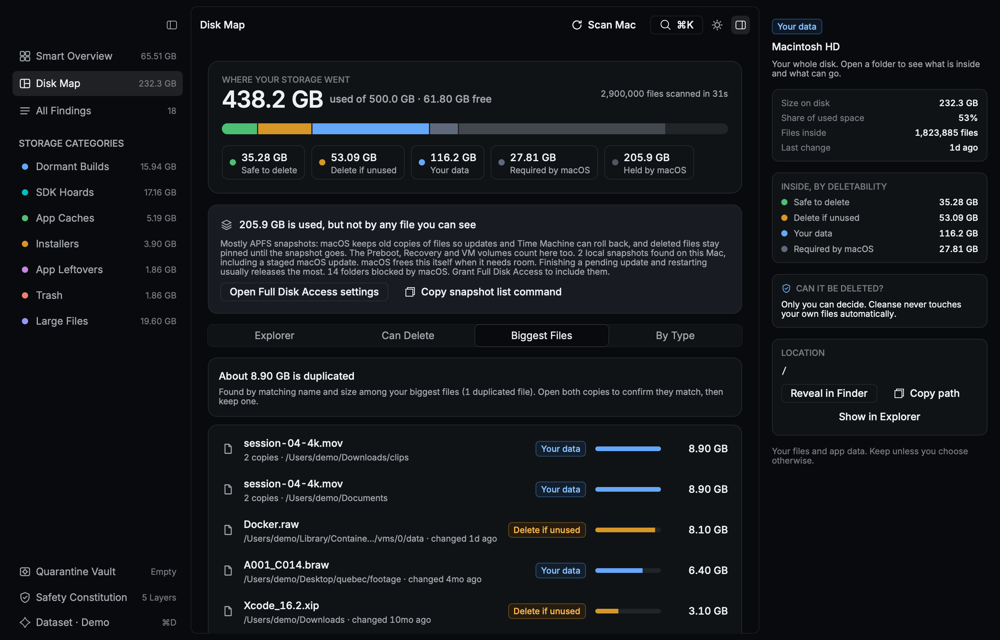

# Cleanse

**See what is eating your disk, where it is, and what is safe to delete. On macOS and Windows.**

Cleanse is a fast, native desktop app written in Rust on the [Rune](https://github.com/anomalyco/rune) UI framework. It scans your whole computer, shows what takes the most space, and tells you for every folder: *can I delete this?*



## Read this first

Cleanse can move files. Know what you are getting into.

| | |
|---|---|
| **Disk Map is read-only** | The whole-disk scan and the verdicts never delete anything. |
| **Cleaning is undoable** | The default sweep moves items into a Quarantine Vault (`~/.clearance-vault`) with one-click **Undo**. Nothing is `rm -rf`'d. |
| **Only regenerable things are offered** | Caches, build output, temp files and old installers. Never documents, photos, mail, keys or system files. |
| **Not code-signed** | Windows SmartScreen and macOS Gatekeeper will warn you. See [Install](#install). |
| **Windows build is newer** | The macOS version was developed and tried on a real Mac. The Windows version is built and tested by CI (unit and headless UI tests), and has had less real-world use. Run it in **Dry Run** first. |
| **No warranty** | MIT licensed, provided as is. Keep backups of anything you care about. |

## Install

Download from the [latest release](../../releases/latest).

### Windows: `Cleanse.exe`
1. Download `Cleanse.exe` and double-click it.
2. SmartScreen says "Windows protected your PC"? Click **More info → Run anyway**. (The app is not signed.)
3. For the most complete scan, run it **as administrator** (right-click → Run as administrator). Without it, some system folders are skipped and reported as "blocked".

### macOS: `Cleanse-macOS.zip` (Apple Silicon and Intel)
1. Unzip and drag **Cleanse.app** to Applications.
2. First launch: right-click the app → **Open** → **Open**. (Not notarized.) Or run `xattr -dr com.apple.quarantine /Applications/Cleanse.app`.
3. For the most complete scan, grant **Full Disk Access**: System Settings → Privacy & Security → Full Disk Access → add Cleanse, then rescan.

## What it does

- **Disk Map.** Every folder on the machine, sized. Drill into any folder. Four views: **Explorer**, **Can Delete**, **Biggest Files**, **By Type**.
- **A verdict on every row.** Each folder and file gets one of four labels, with the reason and how to free it:
  - 🟢 **Safe to delete.** Regenerates by itself (caches, `node_modules`, `target/`, logs, temp files).
  - 🟠 **Delete if unused.** Probably removable, but only you know (apps, old installers, Docker, simulators).
  - 🔵 **Your data.** Yours. Never touched automatically. Anything Cleanse does not recognise lands here.
  - ⚪ **Required by the OS.** Needed to run. Shown so you can see where space goes, not to remove it.
- **Honest about hidden space.** If the disk says 438 GB used but only 230 GB is readable, Cleanse says so and explains why (APFS snapshots and staged updates on macOS; System Restore, hibernation and page files on Windows).
- **Likely duplicates.** Biggest Files flags same-name, same-size copies. It matches by name and size only, so open both before deleting one.
- **Findings and sweeps.** A separate scanner finds regenerable items (package-manager caches, dormant build folders, temp files, installers in Downloads), checks each against a 5-layer safety engine, and lets you sweep them into the Vault, the Trash / Recycle Bin, or run a Dry Run.
- **Fast.** Parallel scan: about 2.5 million files in roughly 40 seconds on an M-series Mac.

| Can Delete | Biggest Files |
|---|---|
|  |  |

## How it keeps you safe

1. **Allow-lists, not deny-lists.** An item must match a known-regenerable pattern to be cleanable at all.
2. **Protected paths.** The OS folders, your profile settings, credentials (`.ssh`, keychains, `.gnupg`), cloud-synced folders (iCloud, OneDrive), mail, photos and `.git` are refused outright.
3. **Build-artifact proof.** A `target/` folder only counts if a sibling `Cargo.toml` and real Cargo markers exist. `node_modules` needs a `package.json`. A folder that merely has that name is left alone.
4. **Running-app check.** Caches owned by a program that is running right now are skipped.
5. **No symlink tricks.** Paths are normalized and symlinks are never followed or removed.

The rules are plain Rust and unit tested. See [`DESIGN.md`](DESIGN.md) and `src/safety.rs`.

## Known limits

- **Windows sizes are approximate.** Windows has no cheap "size on disk", so Cleanse rounds file sizes up to 4 KB clusters. OneDrive online-only files count as zero. Hard links (mostly in `C:\Windows\WinSxS`) can be counted more than once. That folder is OS-owned and never offered for deletion.
- **Run as administrator / grant Full Disk Access** to see everything. Blocked folders are counted and listed, not hidden.
- **Windows cleaning covers** temp files, crash dumps, package-manager caches (npm, pnpm, Yarn, pip, uv, Go, Cargo, Gradle), dormant build folders and installers in Downloads. It does not touch the registry, Windows Update, or Program Files. Use Windows' own Storage settings for those.
- **No automatic "empty the snapshot / System Restore"** feature. Cleanse tells you where the space is and how to free it yourself.

## Build from source

```sh
# Rust 1.97.1 is pinned by rust-toolchain.toml (rustup installs it for you)
cargo run --release
cargo test
```

Windows needs the Visual Studio C++ Build Tools (the MSVC toolchain).

Keyboard: `⌘`/`Ctrl` + `1`–`5` switch views, `R` rescan, `K` command palette.

## License

MIT. See [LICENSE](LICENSE).
